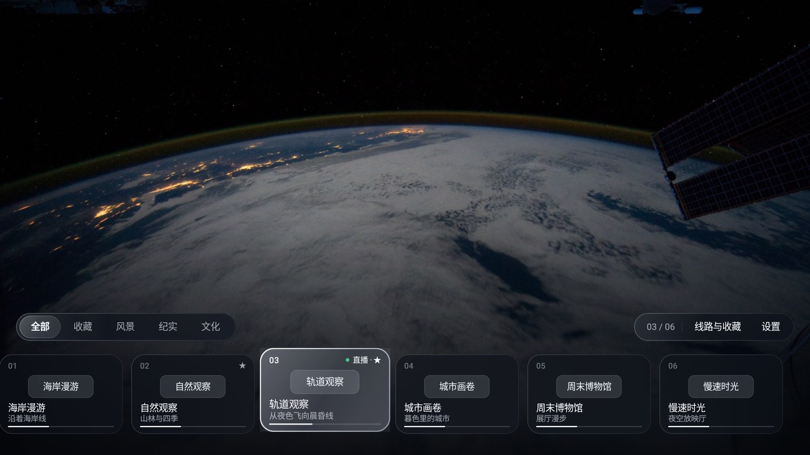
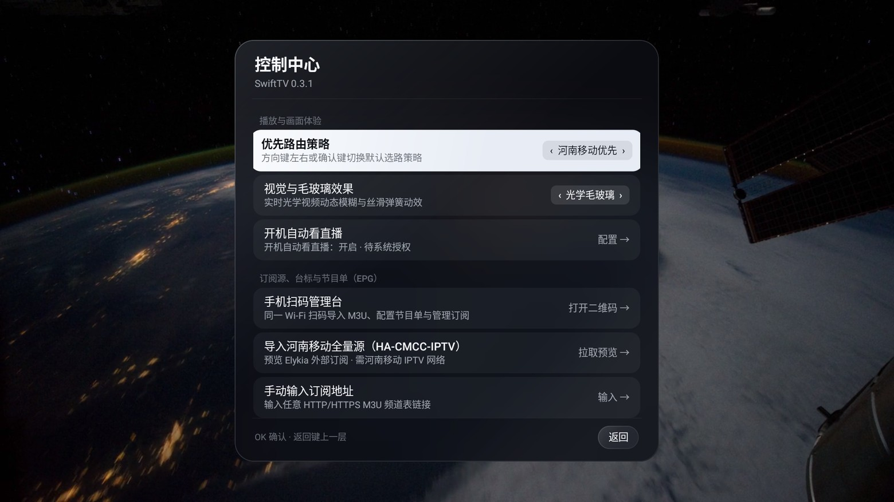
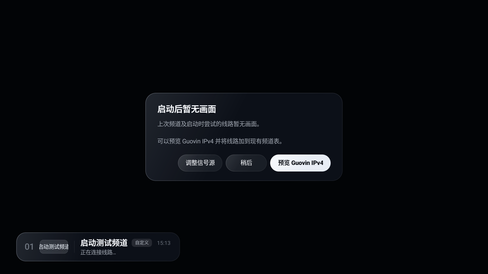

<p align="center">
  
</p>

<h1 align="center">SwiftTV</h1>

<p align="center"><strong>为电视遥控器设计的 Android TV 直播播放器</strong></p>

<p align="center">
  <a href="https://github.com/morangse/SwiftTV/releases/download/v0.3.3/SwiftTV-0.3.3.apk"><strong>下载 APK</strong></a>
  &nbsp;·&nbsp;
  <a href="https://github.com/morangse/SwiftTV/releases/tag/v0.3.3">v0.3.3 发行说明</a>
  &nbsp;·&nbsp;
  <a href="#安装与导入">快速上手</a>
</p>

<p align="center">Android 6.0+（API 23）&nbsp; · &nbsp;M3U / XMLTV&nbsp; · &nbsp;Apache-2.0</p>

<p align="center">
  
</p>

<p align="center"><sub>播放时按确认键或点按画面，打开底部频道画廊。</sub></p>

## 功能

| 功能 | 使用方式 |
| :--- | :--- |
| **频道画廊与收藏** | 按分组浏览频道，支持按央视编号排列、识别 M3U 附带的台标和收藏常看频道。方向键先移动焦点，按确认后再换台。 |
| **原生播放与备用线路** | 基于 Media3 ExoPlayer 播放 HTTP/HTTPS HLS、MPEG-TS 和 HTTP-FLV。同一频道可有多条线路，播放异常时按策略恢复或尝试备用线路，也能手动切换。 |
| **频道表与节目单** | 支持 M3U 网址、本地文件和局域网扫码导入。保存前可预览，远程订阅刷新失败时保留旧表。配置 XMLTV（.xml / .xml.gz）后可查看当前和下一档节目。 |
| **自动选路与无画面提示** | 实时检测设备全局 IPv6 能力并按当前网络优先排序国内运营商 IPv6 与国内源，减少海外中转超时。启动后没有画面时，自动按网络推荐预览 Guovin 国内 IPv6 / 双栈或进入信号源设置。 |
| **开机恢复** | 默认开启开机自动看直播，并记住上次播放的频道。可在「控制中心」关闭。实际开机和待机恢复取决于设备固件与系统权限。 |
| **大屏显示** | 播放画面全屏，画廊和菜单使用半透明面板。低配设备可在「视觉与毛玻璃效果」切换「极速纯色」。 |
| **线路检测与诊断** | 支持对单个频道或当前分类的线路测速，查看首帧和上次播放结果。通过手机扫码导出脱敏 JSON，方便复现播放问题。 |

| 线路与收藏 | 控制中心 |
| :---: | :---: |
| [](docs/screenshots/channel-details.jpg) | [](docs/screenshots/control-center.jpg) |
| 可手动切源、重试或查看检测结果。 | 管理订阅、节目单和开机恢复。 |

<sub>截图采自 MuMu 模拟器中的 SwiftTV 0.3.1。频道、线路与节目名称为演示数据。演示视频由 Earth Science and Remote Sensing Unit, NASA Johnson Space Center 提供。<a href="https://svs.gsfc.nasa.gov/30180/">素材出处</a></sub>

## 安装与导入

1. 在电视上安装 [SwiftTV-0.3.3.apk](https://github.com/morangse/SwiftTV/releases/download/v0.3.3/SwiftTV-0.3.3.apk)。可将 APK 复制到 U 盘，再使用电视的文件管理器打开，或使用下方「手机端局域网安装助手」无线推送。校验文件见 [SHA256SUMS.txt](https://github.com/morangse/SwiftTV/releases/download/v0.3.3/SHA256SUMS.txt)。
2. 打开 SwiftTV 的「控制中心」，添加你有权使用的 M3U 频道表。中国移动 / 联通 / 电信宽带优先推荐「导入 Guovin 国内 IPv6 频道」或「导入范明明精选 IPv6 频道」，不确定是否开启 IPv6 可选「导入 Guovin 双栈全量频道（IPv6 + IPv4）」，也可手动输入订阅地址、选择本地文件或手机扫码导入。
3. 在预览中确认频道，保存后选台播放。若频道表附带有效节目单，SwiftTV 会读取它。也可以在控制中心填写独立的 XMLTV 地址。

**公开版使用用户自行添加的频道表。** [M3U 格式样例](samples/example.m3u)可帮助你整理订阅，示例地址仅用于说明格式。

## 手机端局域网安装助手

仓库内的 [`installer/`](installer/) 是一个独立的 Android 手机应用，用于在没有应用商店、也不想插 U 盘时，通过局域网 ADB 把 SwiftTV 安装到电视：

- 自动扫描同一网段的 5555 端口，并通过 mDNS 发现 Android 11+ 无线调试设备
- 支持手动 IP、电视授权弹窗重试、6 位配对码配对，以及签名冲突后的卸载重装
- 内置 SwiftTV 0.3.3 安装包，可在手机上更换为其他本地 APK
- 识别电视品牌、型号、Android 版本和已安装的 SwiftTV 版本

构建方式（独立 Gradle 工程）：

```powershell
cd installer
.\gradlew.bat :app:assembleRelease --no-daemon
```

产物为 `installer/app/build/outputs/apk/release/app-release.apk`。电视端准备步骤、品牌差异和已知限制见 [installer/README.md](installer/README.md)。

也可以在仓库根目录运行 `.\scripts\build-installer.ps1`，自动执行测试、debug/release 构建并把 APK 复制到 `output/delivery/`。

## 启动后暂无画面

SwiftTV 自动尝试同频道已有的备用线路。启动后约 15 秒没有首帧，或候选线路提前耗尽时，可以从提示直接预览 Guovin 或打开控制中心。首次使用且频道表为空时，控制中心会聚焦 Guovin 导入入口。保存导入前可先预览频道。

「控制中心 → 优先路由策略」可以选择「自动识别」。自动模式根据当前网络上的播放结果选路，已保存的手动策略在升级时保留。Guovin 预设指向上游测试频道表，线路可用性以本机网络实测为准。 [Guovin 官方结果页](https://guovin.github.io/iptv-api/)

<p align="center">
  
</p>

<p align="center"><sub>SwiftTV 0.3.2 在 MuMu 模拟器中的实拍，使用受控测试频道。</sub></p>

## 遥控器操作

| 当前界面 | 操作 | 效果 |
| :--- | :--- | :--- |
| 全屏播放 | <kbd>↑</kbd> / <kbd>↓</kbd> 或频道加减键 | 换台 |
| 全屏播放 | <kbd>OK</kbd>，或点按画面 | 打开频道画廊 |
| 全屏播放 | <kbd>→</kbd> 或菜单键 | 打开线路与收藏 |
| 全屏播放 | 数字键 | 按画廊中的频道序号换台 |
| 频道画廊 | 方向键，随后按 <kbd>OK</kbd> | 选择分组或频道，确认后播放 |
| 任意菜单 | 返回键 | 返回上一级或关闭菜单 |

## 设备与排错

Android TV 6.0（API 23）是最低系统版本，具体画质、HEVC 和 4K 播放取决于电视解码能力与源格式。需要检查时，在「控制中心 → 本机硬件解码能力」查看当前设备的检测结果。

如果某个频道无法播放，可从「线路与收藏」查看失败原因并尝试其他线路。电视无法打开应用文件选择器时，可以从同一局域网的手机扫码导入。反馈问题时可附电视型号、系统版本、复现步骤与脱敏诊断。 [设备与隐私](docs/DEVICE.md) · [提交问题](https://github.com/morangse/SwiftTV/issues)

## 从源码构建

使用 Kotlin、Android 原生 Views、SurfaceView 和 Media3。构建需要 JDK 17、Android SDK Platform 36 和 Android Build Tools 36。将 SDK 路径设为 ANDROID_HOME，或使用 Android Studio 生成本机配置。

    ./gradlew :app:testDebugUnitTest :app:lintDebug :app:assembleDebug

在 Windows 使用 <code>.\gradlew.bat</code> 运行相同任务。构建后的调试 APK 位于 <code>app/build/outputs/apk/debug/</code>。签名和独立测试包参数见 [构建与验证](docs/BUILD.md)。

SwiftTV 使用 [Apache-2.0](LICENSE) 许可证。依赖、图标和第三方素材的来源见 [NOTICE](NOTICE)。
