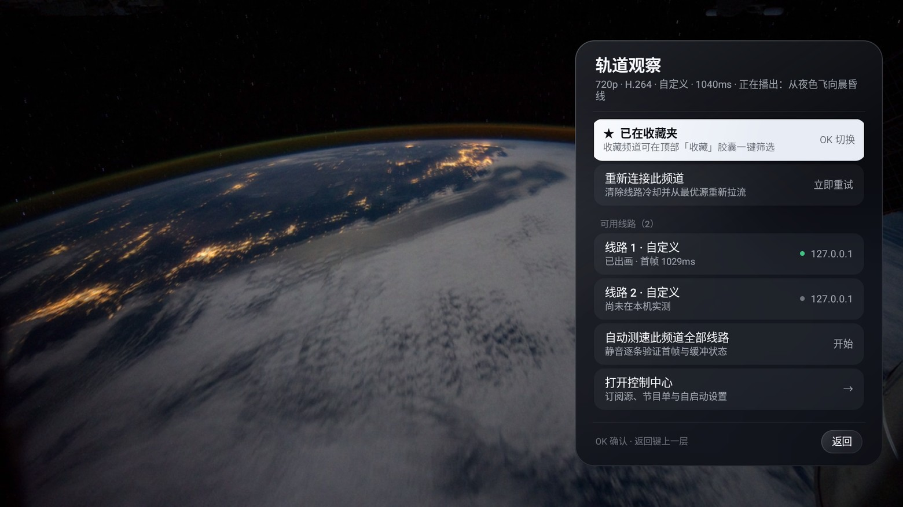

<p align="center">
  
</p>

<h1 align="center">SwiftTV</h1>

<p align="center"><strong>纯粹轻量的 Android TV 本地 / 局域网直播播放器（无内置片源）</strong></p>

<p align="center">
  <a href="https://github.com/morangse/SwiftTV/releases/download/v0.4.1/SwiftTV-0.4.1.apk"><strong>下载 SwiftTV 0.4.1</strong></a>
  &nbsp;·&nbsp;
  <a href="https://github.com/morangse/SwiftTV/releases/tag/v0.4.1">v0.4.1 发行说明</a>
  &nbsp;·&nbsp;
  <a href="#安装与导入">快速上手</a>
  &nbsp;·&nbsp;
  <a href="#社区公开源整理参考">社区源参考</a>
</p>

<p align="center">Android 6.0+（API 23）&nbsp; · &nbsp;M3U / 单频道 HLS (.m3u8) / XMLTV&nbsp; · &nbsp;Apache-2.0</p>

> **定位声明**：SwiftTV 是一个**纯空壳本地播放器**，安装包与源码内不内置、不预设、不分发任何第三方直播源、频道列表或媒体内容。所有频道表、单频道流地址和节目单均由用户自行添加、托管或推送导入。

<p align="center">
  
</p>

<p align="center"><sub>播放时按确认键或点按画面，打开底部频道画廊。</sub></p>

## 核心特性

| 功能 | 说明 |
| :--- | :--- |
| **开箱即扫 · 手机配对导源** | 首次启动或频道列表为空时，直接弹出**局域网配对二维码**；用手机浏览器扫码或直接用 [SwiftTV 安装助手](installer/) 一键推送订阅链接、单频道 `.m3u8` 或手机本地文件，免去电视遥控器输入长网址的麻烦。 |
| **M3U 与单频道 HLS 全兼容** | 支持标准 `#EXTINF` M3U/M3U8 列表、**单频道 HLS 媒体/主清单（`.m3u8`）**、TS / HTTP-FLV / fMP4 直播直链。保存前自动预览，远程订阅刷新失败时保留本地旧表。 |
| **多主机并发测通与极速换源** | 播放切台时不再死等单一线路超时：当头部缺少已验证健康的线路时，最多对 **3 条不同主机**发起并发轻量探测（`2.5s` 超时，读取 `<= 4 KB` 报文头即锁定最快可播流并取消其余请求），配合分级看门狗（`3.5s` 无轨、`7.5s` 首帧）与指数退避冷却。 |
| **按协议自动选路** | 实时检测本机全局 IPv6 连通能力（`LinkProperties`），在「自动识别 / IPv6 优先 / IPv4 优先 / 历史首帧优先」之间调度同频道多条线路。 |
| **遥控器优先的透明大屏 UI** | 方向键先浏览焦点、确认后切换，全屏无遮挡；支持悬浮频道画廊、右侧设置/线路面板、数字键选台、XMLTV 节目单及低配纯色切换。 |
| **线路测速与脱敏诊断** | 支持单频道/分类线路测速；手机扫码可导出路径与密钥脱敏后的诊断 JSON，便于排查本机网络和解码兼容问题。 |

| 线路与收藏 | 控制中心 |
| :---: | :---: |
| [](docs/screenshots/channel-details.jpg) | [](docs/screenshots/control-center.jpg) |
| 可手动切源、测速或查看上次失败原因。 | 管理 M3U/HLS 导入、节目单、选路与开机恢复。 |

<sub>界面预览图采自模拟器测试环境，演示视频素材来自 NASA SVS <a href="https://svs.gsfc.nasa.gov/30180/">30180</a>。</sub>

## 安装与导入

1. **安装到电视**：下载 [SwiftTV-0.4.1.apk](https://github.com/morangse/SwiftTV/releases/download/v0.4.1/SwiftTV-0.4.1.apk)（校验见 [SHA256SUMS.txt](https://github.com/morangse/SwiftTV/releases/download/v0.4.1/SHA256SUMS.txt)）用 U 盘安装，或在手机安装同 Release 提供的 **SwiftTV 安装助手 (`SwiftTV-Installer-1.1.1.apk`)** 通过局域网无线推送安装。
2. **首次启动配对导源**：首次打开 SwiftTV 且尚未导入频道时，界面会直接显示**手机配对二维码**与左侧快速入口（`手动输入地址` / `本地文件` / `控制中心`）。
3. **手机推送直播源（推荐）**：
   - **方式 A（手机浏览器扫码）**：手机与电视在同一 Wi‑Fi 下扫一扫屏幕二维码，可输入远程 `.m3u` / 单频道 `.m3u8` 链接、或直接上传手机本地 `.m3u/.m3u8` 文件并点击发送，电视端按 OK 确认预览即可播放。
   - **方式 B（安装助手 1.1.0 一键推送）**：在手机安装助手中连接电视后，直接在「推送直播源到电视」卡片粘贴 `.m3u` / `.m3u8` 链接或选择手机本地文件，一键发送到电视端弹出确认窗。
4. **单频道清单说明**：如果手头只有一个频道的 `.m3u8`（例如 `#EXT-X-TARGETDURATION` 媒体清单或 `#EXT-X-STREAM-INF` 主清单）或 `.ts`/`.flv` 地址，可直接粘贴 URL 或导入仅含外链的本地 `.m3u8` 文件，SwiftTV 会自动识别为「单频道直连」分组并入库播放（不含基址的本地相对切片清单会明确提示改填线上 URL）。

> 整理个人列表可参考仓库内的格式样例：[samples/example.m3u](samples/example.m3u)。

## 社区公开源整理参考

以下为 GitHub 上广泛传播的开源公开整理项目，仅作为社区技术资料索引方便用户自行检索、甄别并按需导入，项目与 SwiftTV 无任何隶属关系，可用性、合法性及线路时效请用户自行确认并承担责任：

（推荐）个人整理收集测试网站，可自行导入测试
https://morangse.github.io/iptvtest/
| GitHub 项目 | 常见特点 / 格式说明 | 参考订阅地址格式（如项目官方页提供） |
| :--- | :--- | :--- |
| [fanmingming/live](https://github.com/fanmingming/live) | 公开直播源汇总项目，IPv6 资源丰富，附带常见台标与 EPG 参考 | 查看项目仓库 README 获取最新地址 |
| [Guovin/iptv-api](https://github.com/Guovin/iptv-api) | 开源自动采集与测速生成工具，社区镜像常见 `ipv4.m3u` / `ipv6.m3u` / `result.m3u` | 查看其 Releases / 官方页面说明 |
| [Elykia093/HA-CMCC-IPTV](https://github.com/Elykia093/HA-CMCC-IPTV) | 区域移动宽带网络测试整理清单 | 查看项目仓库文件说明 |
| [YueChan/Live](https://github.com/YueChan/Live) | IPv6/IPv4 开源节目源整理仓库 | 查看项目仓库目录 |
| [vbskycn/iptv](https://github.com/vbskycn/iptv) | 长期维护的组播 / 单播汇总与 EPG 仓库 | 查看项目仓库 README |
| [Kimentanm/aptv](https://github.com/Kimentanm/aptv) | 常见跨平台直播源聚合仓库 | 查看项目仓库 README |

> **如何导入**：在手机上复制目标仓库提供的原始 `.m3u` / `.m3u8` Raw 地址（或下载 `.m3u` 到手机），打开 SwiftTV 安装助手一键推送，或扫电视屏幕二维码提交即可。

## 手机端局域网安装与推源助手

仓库内的 [`installer/`](installer/) 是一个独立的 Android 手机伴侣应用（`SwiftTV 安装助手 1.1.1`），用于在无 U 盘环境下通过局域网 ADB 安装 SwiftTV 并推送直播源：

- 自动扫描同网段 `5555` 端口，并通过 mDNS 发现 Android 11+ 无线调试设备
- 支持手动 IP、授权弹窗自动重试、6 位配对码（SPAKE2 + Conscrypt），以及签名冲突卸载重装
- 内置 `SwiftTV 0.4.1` 安装包，也支持在手机上选择其他本地 APK
- **1.1.0 新增推源能力**：在手机上粘贴 M3U 订阅 / 单频道 `.m3u8` 链接（可选列表名与 EPG）或挑选本地 `.m3u/.m3u8` 文件（内置随机一次性令牌 LAN 短暂托管），一键唤起电视端确认导入

构建方式（独立 Gradle 工程）：

```powershell
cd installer
.\gradlew.bat :app:assembleRelease --no-daemon
```

或使用仓库脚本 `.\scripts\build-installer.ps1`。详见 [installer/README.md](installer/README.md)。

## 遥控器操作

| 当前界面 | 操作 | 效果 |
| :--- | :--- | :--- |
| 全屏播放 | <kbd>↑</kbd> / <kbd>↓</kbd> 或频道加减键 | 换台（默认 <kbd>↓</kbd> 下一个、<kbd>↑</kbd> 上一个，可在控制中心反转；支持 4 挡长辈大字） |
| 全屏播放 | <kbd>OK</kbd>，或点按画面 | 打开频道画廊 |
| 全屏播放 | <kbd>→</kbd> 或菜单键 | 打开线路与收藏 |
| 全屏播放 | 数字键 | 按画廊中的频道序号换台 |
| 频道画廊 | 方向键，随后按 <kbd>OK</kbd> | 选择分组或频道，确认后播放 |
| 任意菜单 | 返回键 | 返回上一级或关闭菜单 |

## 设备与从源码构建

最低支持 **Android TV 6.0（API 23）**，4K / HEVC 解码与实际画面表现取决于电视硬件能力，可在「控制中心 → 本机硬件解码能力」查看检测结果。

构建需要 JDK 17、Android SDK Platform 36 与 Build Tools 36：

```powershell
.\gradlew.bat :app:testDebugUnitTest :app:lintDebug :app:assembleDebug
```

更多签名、验证与隐私说明见 [docs/BUILD.md](docs/BUILD.md) 和 [docs/DEVICE.md](docs/DEVICE.md)。SwiftTV 使用 [Apache-2.0](LICENSE) 许可证，第三方依赖声明见 [NOTICE](NOTICE)。
